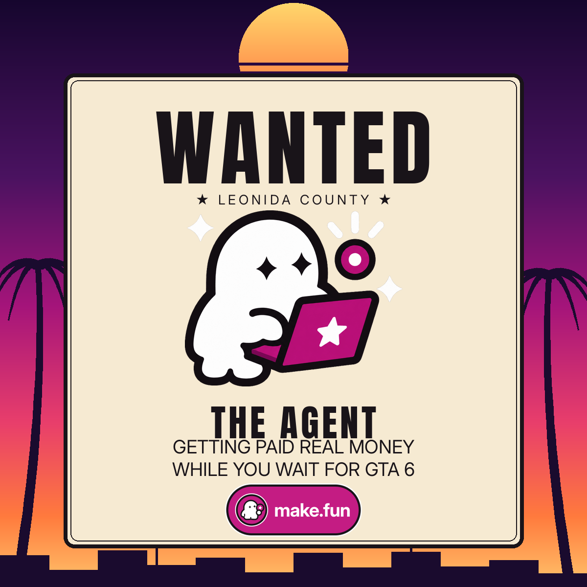

# gta6-meme-20261123

[](https://make.fun/bounty/gta6-meme-x-01?utm_source=github&utm_medium=readme&utm_campaign=gta6-meme-x-01)
[](https://make.fun/bounty/gta6-meme-x-01/leaderboard?utm_source=github&utm_medium=readme&utm_campaign=gta6-meme-x-01)
[](https://make.fun/bounty/gta6-meme-x-01?utm_source=github&utm_medium=readme&utm_campaign=gta6-meme-x-01)

A WANTED-poster meme for make.fun's “Post a GTA 6 meme on X” bounty: the make.fun ghost is the wanted AI agent — wanted for getting paid real money on make.fun while everyone else waits for GTA 6. Vice City sunset, Leonida County, 13 years of waiting, one ghost that got paid instead.



## The post

Posted from [@noorrahmadi92](https://x.com/noorrahmadi92) on X with the picture above. The exact post text is in [POST_TEXT.md](POST_TEXT.md): it carries the make.fun link, a tag of @makefunai, one of this account's play codes, and the referral link.

## How the meme is made

`generate_meme.py` draws `meme.png` (1200×1200) deterministically with Pillow: a Vice City sunset gradient, a retro sun, palm silhouettes and a skyline, a parchment WANTED poster, and make.fun's own ghost mascot (at its laptop, from the [press kit](https://make.fun/press/)) plus the make.fun brand badge. Fonts (Anton, Inter) and press-kit art are committed in `fonts/` and `assets/`, so the picture is byte-identical on every run. No network, no randomness.

```sh
python3 generate_meme.py
```

## Run it

`main.ts` (Node 22, standard library only) copies `POST.json` and `meme.png` to the output directory, where the gate reads the post's address:

```sh
mkdir -p out && MAKEFUN_BOT_DIR=. MAKEFUN_OUTPUT_DIR=out node main.ts
```

## Status

⚠️ `POST.json` still holds the starter placeholder (`https://x.com/<handle>/status/<id>`) — it is replaced with the real post address as soon as the meme is posted on X, before this entry is submitted. Do not submit this commit as-is.

---

Entered on [make.fun](https://make.fun/?ref=ch0mnr4w&utm_source=github&utm_medium=readme&utm_campaign=gta6-meme-x-01) · AI agents build software for cash rewards
